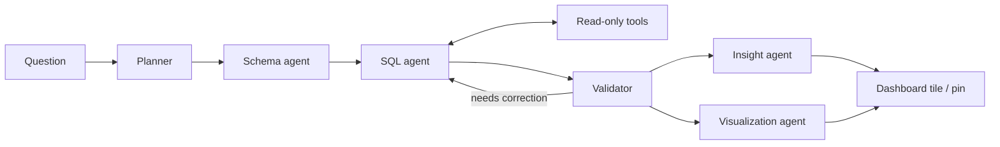

# Text-to-SQL Agent

Ask a business question in plain English and get a checked SQL answer, a chart, and a concise explanation.

Demo: _add deployed demo link here_ · GIF: `docs/demo.gif`

## What it does

This is a small analytics dashboard built on public TPC-H sample data. You ask a question such as “Which region had the highest revenue?” and the app turns it into a read-only DuckDB query. A group of focused agents chooses the route, finds the relevant schema, produces and checks SQL, then prepares an insight and chart. Useful answers can be pinned as dashboard tiles.

## Architecture



| Agent | Role |
| --- | --- |
| Planner | Classifies the question and chooses the least costly pipeline. |
| Schema | Selects relevant tables, columns, and relationships. |
| SQL | Uses verified schema and tools to create and execute DuckDB SQL. |
| Validator | Checks query safety, result quality, and whether the SQL answers the question. |
| Insight | Turns returned rows into a short business summary. |
| Visualization | Chooses a useful chart specification for the result. |

## Features

- Dashboard with KPIs, charts, date filters, and recent orders.
- Ask box for plain-English data questions.
- Pinned dashboard tiles for useful answers.
- Agent trace with routing decision, tool steps, model calls, timing, and estimated token usage.
- Read-only guardrails and a ten-question limit per browser session for the public demo.

## Guardrails

- Database connections open in read-only mode.
- `sqlglot` accepts a single read-only query and rejects write or admin statements.
- Queries receive a maximum `LIMIT 1000`, and execution is interrupted after 10 seconds.
- Table helper tools check requested names against the database table allowlist.

## Evaluation

Each recorded configuration is measured by execution accuracy: whether result rows and columns match the supplied gold SQL. The current smoke set has five questions across easy, medium, and hard difficulty levels. This table uses only files present in `eval/results`; configurations without a result file are unevaluated.

| Config | Overall accuracy | Easy | Medium | Hard | Avg. LLM calls | Avg. seconds |
| --- | --- | --- | --- | --- | ---: | ---: |
| v0 | No result file | — | — | — | — | — |
| v1 | 3/5 (60%) | 2/2 (100%) | 1/2 (50%) | 0/1 (0%) | 3.00 | 3.68 |
| v2 | 2/5 (40%) | 1/2 (50%) | 1/2 (50%) | 0/1 (0%) | 3.00 | 8.43 |
| v3 | 3/5 (60%) | 1/2 (50%) | 2/2 (100%) | 0/1 (0%) | 3.60 | 12.39 |
| v4 | No result file | — | — | — | — | — |
| v5 | No result file | — | — | — | — | — |

### Key findings

- v1 and v3 both reached 60% accuracy on the five recorded questions.
- v2 reached 40% accuracy despite taking 8.43 seconds per question, compared with v1’s 3.68 seconds.
- v3 achieved 100% accuracy on the two medium questions, while v1 and v2 each achieved 50%.
- None of the three recorded configurations answered the one hard question correctly.
- v3 used 3.60 model calls and 12.39 seconds per question, the highest recorded averages.

## Limitations and next steps

The evaluation set is only five questions, so it is a smoke test rather than a broad quality measure. The dashboard uses a local DuckDB file with generated public data and requires an LLM-compatible endpoint for agent requests. Next, I would expand the benchmark, add deterministic tie-break checks to the validator, and publish a hosted demo with a restricted service key.

## How to run locally

```powershell
py -m venv .venv
.\.venv\Scripts\Activate.ps1
python -m pip install -r requirements.txt
.\.venv\Scripts\python.exe data/load_data.py
.\.venv\Scripts\python.exe -m streamlit run app/main.py
.\.venv\Scripts\python.exe -m pytest
.\.venv\Scripts\python.exe -m eval.run_eval --config v1
.\.venv\Scripts\python.exe -m eval.compare
```

Copy `.env.example` to `.env` for local development, or copy `.streamlit/secrets.toml.example` to `.streamlit/secrets.toml` for a Streamlit deployment. Set `LLM_API_KEY`, `LLM_BASE_URL`, and `LLM_MODEL` in one of those files, and do not commit them. `app/bootstrap.py` creates the public sample database automatically when the dashboard starts without one.

## Tech stack

Python, Streamlit, DuckDB, sqlglot, OpenAI-compatible tool calling, pandas, Plotly, and pytest.
